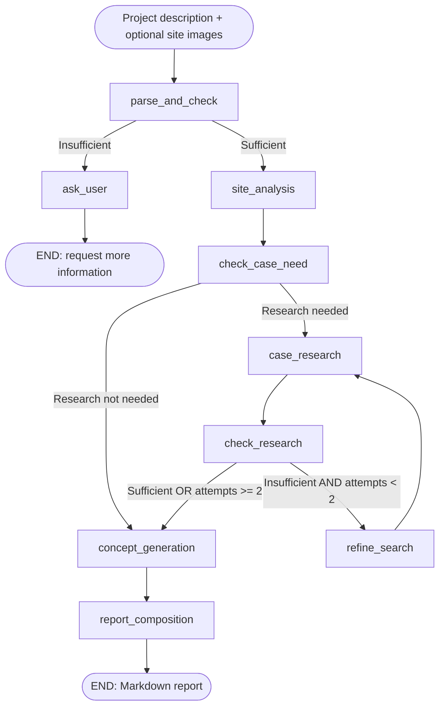

# Design Pre-study Agent

面向城市设计前期阶段，辅助完成场地分析、案例研究、机会识别和概念方向生成，输出可用于前期讨论的 Markdown 研究报告。

## Overview

城市设计前期研究需要在项目理解、场地判断、外部案例和概念推导之间反复整理信息。本项目将这些任务组织为可观察、可测试、可评测的 Agent 工作流，面向城市设计团队、前期研究人员与 Agent 开发者。

输入为项目描述、需求与可选场地图片；输出为结构化研究成果、2–3 个概念方向及报告。结果用于方向探索，不替代正式规划、详细设计或专业审核。

## What It Does

- 理解项目背景、区位关系、规划条件与客户需求；真正信息不足时追问。
- 分析场地条件与 SWOT，支持文字和图片输入。
- 判断案例研究是否必要，检索来源并提取可迁移策略。
- 识别设计机会、形成结构化 Vision 和 2–3 个概念方向。
- 按运行配置生成意向图；图片失败时继续输出概念与报告。
- 生成最终 Markdown 报告，Streamlit 展示结果并保存本地输出。

## Agent Workflow



固定 9 个业务 Node。案例研究最多两轮；Concept 内部最多自动重新生成一次。图片生成属于 Concept Skill，不是额外 Node。补充信息由前端合并原始输入后重新 invoke，使用 ask_user → END，不使用 Interrupt / Checkpoint。

## Architecture

**Single Agent + Single LangGraph StateGraph**，分层职责为：

| Layer | Responsibility |
|---|---|
| Graph / Routes | 编排、路由与业务循环 |
| Nodes | 读取 AgentState，执行判断或调用 Skill，返回 partial update |
| Skills | 完成专业研究任务 |
| Tools | 提供外部检索与图片生成能力 |
| LLM infrastructure | 统一配置、文本/多模态输入、JSON 解析、Pydantic 校验与有限技术重试 |

AgentState 顶层为 TypedDict，复杂输出通过 Pydantic 校验。技术重试独立于案例研究轮次和概念重生成。Provider 参数留在基础设施与 Tool 层。

## Skills & Tools

| Skill | Task |
|---|---|
| Site Analysis | 项目定位、场地条件与嵌套 SWOT |
| Case Research | 查询、证据筛选、专业分析与来源绑定 |
| Concept Generation | 机会、Vision、概念、内部质量检查与意向图 |
| Report Composition | 组织已有成果，不重新生成前序业务结论 |

外部能力：**Tavily Search**、**Qwen Image**、统一 **Qwen 文本/多模态 LLM** 接口。多模态理解由 LLM 基础设施完成，不另设视觉分析 Tool。Qwen 使用 OpenAI-compatible API 和 openai SDK。

## Key Design Decisions

1. **Single Agent + explicit workflow**：保留清晰的任务边界、条件路由与失败观察，便于验证闭环。
2. **Minimum viable research input**：研究对象可识别、有至少一组有意义的场地条件、研究意图可识别且无核心矛盾，即可启动前期研究。城市名、FAR、CAD 等缺失不能单独阻断。
3. **Bounded case research**：最多两轮；证据仍不足时保留 research gaps 并继续概念与报告，避免无限搜索。
4. **Deterministic provenance**：为当前 evidence 分配 source_id，LLM 只选择 ID 与专业字段，程序回填同一 evidence 的原始 title / 完整 URL。避免模型改写、截断标题或输出裸域名；未知 ID 拒绝，exact guard 保持不变。

完整设计见 [Agent Architecture](docs/03-agent-design/agent-architecture.md) 与 [Design Decisions](docs/03-agent-design/design-decisions.md)。

## Demo

- [Case 02 — Multimodal Site Understanding](docs/demo/case-02.md)：固定场地图与文字输入共同支持场地理解。
- [Case 08 — Multi-constraint Concept Generation](docs/demo/case-08.md)：同时回应 TOD、历史建筑、滨水公共性、道路阻隔与社区需求。

Demo 从已保存的最终 Regression 报告提取，未重新生成；该轮禁用生成图片，展示文本研究链路。另有 [滨水项目输入样例](data/samples/waterfront.md)。

## Evaluation

Dataset V1.0 包含 **10 cases**，用于项目级回归与 failure-driven iteration，不是大规模 benchmark。三层分别评价：规则型 Decision / Workflow、固定 Rubric 的 LLM-as-Judge Quality、Operational metrics；不计算 Overall Score。

| Metric | Initial v0.1 | Final Regression |
|---|---:|---:|
| Info Sufficiency Accuracy | 30% | 100% |
| Completion | 10% | 100% |
| Report completed | 0 | 9 |
| Agent execution failure rate | 20% | 0% |

Final：9/9 sufficient cases 生成报告，1/1 insufficient case 正确追问；source consistency failure 与 Judge failure 均为 0。Completion 包括 Case 03 的正确追问结束，不意味着十个报告。

| Quality Metric | Mean (1–5) | Valid cases |
|---|---:|---:|
| Site Analysis | 4.83 | 6 |
| Case Research | 3.75 | 4 |
| Groundedness | 4.57 | 7 |
| Concept Quality | 4.20 | 5 |
| End-to-End Usability | 4.00 | 2 |

N/A 和 unavailable 不进入均值分母。四项代表性人工抽检与 Judge 评分基本一致，仅为有限抽检观察，不证明 Judge 全面可靠。历史阶段模型曾变化，不能将全部前后差异当作严格单变量实验；同为 qwen3.7-flash 的 v0.2 对照中，source failures 从 8 降至 0。

真实 Image Generation 已通过独立 Provider Smoke。Dataset 保留 required / optional / disabled 策略；正式 Final Evaluation 使用显式 Eval-only quota override 关闭真实生图（image_calls=0），Case 02 输入图片不受影响，**不包含 Image Quality benchmark**。

详细证据与限制见 [Evaluation Results](docs/04-evaluation/results.md)、[Framework](docs/04-evaluation/evaluation-framework.md) 和 [Dataset Design](docs/04-evaluation/dataset-design.md)。

## Getting Started

需要 Python **3.11+**。项目仓库：[Deng-odd/design-prestudy-agent](https://github.com/Deng-odd/design-prestudy-agent)。

```bash
git clone https://github.com/Deng-odd/design-prestudy-agent.git
cd design-prestudy-agent
python -m venv .venv
```

激活虚拟环境：Windows PowerShell 使用 `.venv\Scripts\Activate.ps1`；Linux/macOS 使用 `source .venv/bin/activate`。然后：

```bash
python -m pip install -e ".[test]"
python -c "from shutil import copyfile; copyfile('.env.example', '.env')"
```

在本地 `.env` 填写 LLM_MODEL、DASHSCOPE_API_KEY 与 TAVILY_API_KEY，再启动：

```bash
streamlit run src/frontend/app.py
```

在页面输入项目描述、上传可选 PNG/JPG/JPEG，并点击“开始研究”。需要补充时填写追问；前端保留图片并重新调用 Graph。报告与持久化图片保存到 `outputs/<run_id>/`。不要提交 `.env`。

## Configuration

[.env.example](.env.example) 是可复制的配置模板；统一由 src/config.py 加载。关键项：

| Variable | Meaning |
|---|---|
| LLM_PROVIDER / LLM_MODEL | qwen / 当前账号实际可调用型号；评测使用 qwen3.7-flash |
| DASHSCOPE_API_KEY | Qwen LLM 与 Image 共用凭据，模板留空 |
| LLM_BASE_URL | 默认 https://dashscope.aliyuncs.com/compatible-mode/v1；地域或 Workspace 不同时覆盖 |
| WEB_SEARCH_PROVIDER / TAVILY_API_KEY | tavily / 搜索凭据，模板 Key 留空 |
| WEB_SEARCH_MAX_RESULTS | 默认 10 |
| IMAGE_PROVIDER / IMAGE_MODEL | qwen / qwen-image-3.0-pro |
| IMAGE_TIMEOUT_SECONDS / IMAGE_MAX_RETRIES | 120 / 2 |
| TOOL_MAX_RETRIES / LLM_MAX_RETRIES | 搜索与 LLM 技术重试，分别默认 2 |
| MAX_SEARCH_ATTEMPTS / MAX_CONCEPT_REGENERATIONS | 2 / 1 |
| USE_IMG2IMG | 默认 false；允许且参考图适用时使用支持的参考模式 |

图片输入需要配置的同一 LLM_MODEL 支持视觉能力，不自动切换备用模型。产品生图默认按 Concept Skill 与配置执行；Eval override 不改变产品行为。

## Running Evaluation & Tests

默认测试离线，Provider integration tests 与普通测试隔离：

```bash
pytest tests/ -v
```

真实 Eval 需要相应凭据，会产生 LLM / Search 调用；以下命令只展示用法，不是离线评测：

```bash
# One case; no real image generation, including required cases
python -m evals.run_eval --case case_10 --disable-image-generation

# Full frozen Dataset; reproduce the image_calls=0 quota policy
python -m evals.run_eval --all --disable-image-generation

# Honor Dataset policies; optional images on, required images also run
python -m evals.run_eval --case case_08 --images on
```

`--images off` 仅关闭 optional 生图，**不能覆盖 required**。`--disable-image-generation` 强制该次 Eval 跳过所有真实生图，包括 Case 10；不跳过 Concept、Report 或 Case 02 输入图片，不修改 Dataset。metadata.json 与单 Case execution 明确记录 override、原始 Dataset policy 和实际 image_calls；不把跳过生图记为 Agent failure。

结果保存到 outputs/evals/<run_id>/，包括 Case JSON、execution trace、检索 evidence、分层 summary 和运行 metadata。Judge failure 记 unavailable 并继续其他指标与 Case。CLI 可复现工作流和 quota 策略；动态检索与模型输出意味着重新执行不保证逐字报告或相同分数。不要覆盖历史结果目录。

## Repository Structure

```text
src/        Agent, Schemas, Skills, Tools, Prompts, LLM/config, Streamlit
evals/      Dataset loader, rule metrics, Judge, evaluation runner
data/       Frozen evaluation cases, fixed asset, sample input
docs/       Product/task/agent design, evaluation results, exported demos
tests/      Offline behavior and infrastructure tests
outputs/    Local runs and diagnostics (Git-ignored)
```

## Known Limitations & Non-goals

- Case 05 在低案例研究边际价值场景仍倾向搜索，可能增加成本；当前不继续优化。
- 搜索摘要、生成推理与策略适用性仍需专业审阅；来源精确绑定不等于事实全文核验。
- 十 Case 与有限人工抽检不足以外推通用性能；正式 Eval 未评价图片美学质量。
- 外部检索、模型响应和临时图片 URL 存在运行时变化；Frontend 保存生成图片到本地。
- V1 不包括 Multi-Agent、RAG/GIS/MCP、长期 Memory、登录/数据库、PDF/PPT/DOCX 导出或自动详细设计。

后续可扩展评测样本与人工校准，但不改变当前冻结 Dataset 来追求更高得分。

## License

MIT License，见 [LICENSE](LICENSE)。Copyright © 2026 Deng-odd。引用的网页内容与第三方素材遵循各自权利和许可。
