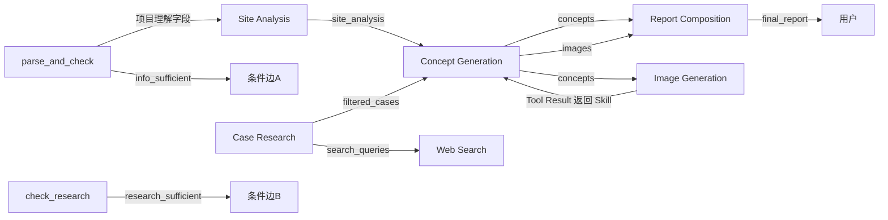

# 产品需求文档（PRD）

## 1. 用户流程

### 1.1 总体流程

用户上传项目资料后，Agent 根据任务状态自主规划研究流程，依次完成项目理解、场地分析、案例研究、设计机会识别、概念方向生成和报告输出。

```text
项目资料输入
      ↓
项目理解与信息提取
      ↓
判断信息是否足够
      ├─ 不足 → 请求用户补充信息
      └─ 足够 → 场地条件分析
                    ↓
              判断是否需要案例研究
                    ├─ 需要 → 案例检索与分析
                    │              ↓
                    │        判断案例研究是否满足需求
                    │              ├─ 不满足 → 调整搜索方向（最多2轮）
                    │              └─ 满足 → 设计机会识别
                    │
                    └─ 不需要 → 设计机会识别
                                   ↓
                         概念方向生成
                                   ↓
                         概念质量判断
                                   ├─ 不满足 → 重新生成（最多1轮）
                                   └─ 满足 → 意向图生成
                                                ↓
                                         研究报告输出
```

---

## 1.2 流程说明

|步骤|触发条件|是否可跳过|
|-|-|-|
|项目理解与信息提取|用户上传项目资料后执行|否|
|信息充分性判断|项目理解完成后执行|否|
|场地条件分析|基础信息满足后执行|否|
|案例研究|Agent判断需要参考外部经验时执行|是|
|设计机会识别|场地分析完成后执行|否|
|概念方向生成|设计机会识别完成后执行|否|
|概念质量判断|概念方向生成后执行|否|
|意向图生成|概念方向生成后默认尝试，失败时允许图片为空|失败时继续报告|
|报告输出|研究流程完成后执行|否|

---

# 2. 功能需求

## 2.1 项目资料输入

### 功能描述

支持用户输入项目基础资料，为 Agent 提供研究上下文。

### 输入内容

|类型|说明|是否必填|
|-|-|-|
|项目描述|项目背景、区位条件、规划条件、甲方诉求|是|
|场地图像|地图、卫星影像、现状照片、规划分析图|否|
|设计目标|用户关注的问题或方向|否|
|指定案例|用户指定参考项目|否|

用户指定研究方向或案例作为任务初始输入，或在重新发起任务时提供，统一并入 `user_input`。V1 不在运行过程中暂停等待研究方向确认或修改。

### 输出

形成结构化项目基础信息：

```json
{
  "project_background": "",
  "location": "",
  "planning_conditions": {},
  "client_requirements": null,
  "site_image_description": ""
}
```

### 对应节点

`parse_and_check`

`client_requirements` 的类型统一为 `str | None`；有要求时保存文字，无要求时为 `None`（JSON 中为 `null`）。

---

# 2.2 信息充分性判断

## 功能描述

Agent 判断当前输入是否足够支持后续研究流程。

## 判断内容

|检查项|判断标准|是否必须|
|-|-|-|
|项目基本信息|能够判断项目类型、功能定位或发展目标|是|
|场地空间信息|包含地图、卫星图、照片或基本空间文字描述；图片本身可选|是|
|设计目标|用户明确提出关注方向|否|

## 输出

```json
{
  "info_sufficient": true,
  "missing_critical": [],
  "missing_optional": [],
  "followup_question": ""
}
```

## 行为

- 信息满足 → 进入场地分析；
- 缺少关键资料 → 请求用户补充。

仅 `missing_critical` 非空时阻断流程；`missing_optional` 只作提示。实际 Graph 为 `ask_user → END`，用户补充后由前端合并输入并重新调用 `graph.invoke()`，从 `parse_and_check` 开始；V1 不使用 Interrupt / Checkpoint。

## 对应节点

`parse_and_check`→ 条件边 A → `ask_user`

---

# 2.3 场地条件分析

## 功能描述

分析项目条件，形成设计研究基础。

## 分析内容

|维度|分析内容|
|-|-|
|项目定位|项目类型、功能定位、发展目标|
|场地资源|蓝绿资源、自然条件、公共空间资源|
|城市关系|周边功能、交通联系、城市界面|
|空间条件|开放空间、潜在问题、发展机会|
|条件总结|优势、劣势、机会、风险|

## 输出

```json
{
  "site_analysis": {
    "project_positioning": "",
    "location_conditions": {},
    "functional_conditions": {},
    "landscape_resources": {},
    "public_space": {},
    "transportation": {},
    "spatial_conditions": {},
    "swot": {
      "strengths": [],
      "weaknesses": [],
      "opportunities": [],
      "threats": []
    },
    "analysis_summary": ""
  }
}
```

## 对应 Skill

`Site Analysis Skill`

## 图像读取

场地图像由多模态模型直接读取，不设置独立 Image Analysis Tool。无图片时使用用户提供的空间文字描述完成分析。

---

# 2.4 案例研究

## 功能描述

Agent 根据项目条件判断是否需要案例参考，并完成案例搜索与分析。

## 判断因素

Agent综合判断：

- 项目类型是否存在成熟案例；
- 当前设计问题是否需要外部参考；
- 是否需要寻找空间组织策略；
- 用户是否指定参考项目。

## 执行流程

```text
分析项目特征

↓

生成案例研究方向

↓

调用搜索工具

↓

筛选相关案例

↓

分析空间策略

↓

判断研究是否满足需求
```

## 输出

```json
{
  "research_direction": [],
  "filtered_cases": [
    {
      "name": "",
      "location": "",
      "project_type": "",
      "source": "",
      "relevance": ""
    }
  ],
  "case_analysis": [
    {
      "case": "",
      "relevance_reason": "",
      "spatial_strategy": [],
      "applicable_reference": [],
      "limitations": []
    }
  ],
  "research_sufficient": true,
  "search_attempts": 1
}
```

## 对应 Skill

`Case Research Skill`

以上是案例研究阶段的 State 结果，不是 Skill 的完整返回值。`research_direction` 由 `check_case_need` 产生，`research_sufficient` 由 `check_research` 产生；`search_attempts` 由 `case_research` Node 更新，Case Research Skill 不返回或修改该字段。

## 调用 Tool

`Web Search`

## 对应节点

- `check_case_need`
- `case_research`
- `check_research`
- `refine_search`

---

# 2.5 设计机会识别

## 功能描述

综合场地分析和案例研究结果，提炼设计机会和目标愿景。

## 输入

- 场地分析结果；
- 案例研究结果。

## 输出

```json
{
  "opportunities": [
    {
      "opportunity": "",
      "basis": "",
      "priority": "high"
    }
  ],
  "vision": {
    "theme": "",
    "positioning": "",
    "core_goal": "",
    "spatial_idea": ""
  }
}
```

## 对应 Skill

`Concept Generation Skill`

内部流程：

- Opportunity Identification
- Vision Extraction

---

# 2.6 概念方向生成

## 功能描述

根据设计机会生成多个概念方向，为设计人员提供方案探索参考。

## 输出数量

2-3个方向。

## 单个方向包含

|内容|说明|
|-|-|
|概念名称|方向主题|
|核心理念|设计目标|
|空间策略|实现方式|
|参考依据|对应场地条件或案例|

## 输出

```json
{
  "concepts": [
    {
      "name": "",
      "core_concept": "",
      "design_opportunities": [],
      "spatial_strategy": "",
      "key_actions": [],
      "case_references": []
    }
  ]
}
```

## 对应 Skill

`Concept Generation Skill`

---

# 2.7 概念质量判断

## 功能描述

Agent 判断生成的概念方向是否满足基本要求。

## 判断内容

|指标|判断标准|
|-|-|
|方向数量|是否达到2-3个|
|差异性|不同方向是否具有明显区别|
|依据充分|是否基于场地条件或案例|
|表达完整|是否包含理念和空间策略|

## 行为

- 满足 → 进入意向图生成；
- 不满足 → 重新生成一次。

质量判断仅在 Concept Generation Skill 内部执行，`quality_check` 不进入 State，也不增加 Graph Node。最多重新生成 1 次；第二次生成后直接返回当前结果，不再继续循环。

---

# 2.8 意向图生成

## 功能描述

根据概念方向调用图像生成能力，形成空间表达参考。

## 输入

- 概念方向；
- 空间策略；
- 场地特征。

## 输出

概念空间意向图：

- 每个方向1-2张。

V1 默认尝试生成意向图，不增加“是否生成意向图”的任务级 State 字段。生成失败时允许 `images` 为空或部分成功，继续报告输出。

## 对应能力

`Image Generation Tool`

---

# 2.9 报告生成

## 功能描述

自动组织研究过程和结果，形成前期研究报告。

## 报告结构

```text
1. 项目理解

2. 场地条件分析

3. 案例研究

4. 设计机会识别

5. 概念方向建议

6. 空间意向图
```

## 输出

Markdown格式研究报告。

## 对应 Skill

`Report Composition Skill`

---

# 3. Agent决策逻辑

## 3.1 核心决策项

|决策|输入|输出|
|-|-|-|
|是否需要补充信息|项目资料完整性|继续/追问|
|是否需要案例研究|项目类型、设计问题、用户需求|调用/跳过|
|案例是否充分|案例数量、相关性、覆盖度|继续/重新搜索|
|是否重新生成概念|概念质量判断|输出/重新生成|

---

## 3.2 案例研究循环

判断条件：

- 是否存在相关案例；
- 是否覆盖主要设计问题；
- 是否具备可借鉴空间策略。

循环限制：

- 最多2轮搜索；
- 超过限制后带限制说明继续生成。

---

## 3.3 概念生成循环

判断条件：

- 是否生成多个方向；
- 是否具有差异性；
- 是否有明确依据。

循环限制：

- 最多重新生成1轮。
- 第二次生成后直接返回当前结果，不再继续循环；该过程仅在 Concept Generation Skill 内部执行。

---

# 4. 人机协作节点

|节点|用户操作|触发时机|
|-|-|-|
|信息补充|补充项目资料|Agent判断信息不足|
|案例方向指定|提供研究方向或指定案例|任务初始输入或重新发起任务时|
|概念方向选择|由设计人员选择偏好的方向，不暂停 Graph|报告输出后|
|方向调整|修改概念要求并重新发起任务|报告输出后|

---

# 5. 功能优先级

## P0 核心流程

|功能|对应能力|
|-|-|
|项目输入与理解|parse_and_check|
|场地分析|Site Analysis Skill|
|案例研究|Case Research Skill|
|设计机会识别|Concept Generation Skill|
|概念方向生成|Concept Generation Skill|
|报告生成|Report Composition Skill|

---

## P1 增强能力

|功能|说明|
|-|-|
|信息不足追问|ask_user|
|案例循环搜索|refine_search|
|意向图生成|Image Generation Tool|

V1 最终报告只输出 Markdown，不实现 HTML / PDF / PPT / DOCX 导出。

---

## P2 后续探索

|功能|说明|
|-|-|
|GIS空间分析|接入专业空间数据|
|自动空间布局生成|超出概念研究范围|
|多Agent协作|架构升级|

---

# 6. 非功能需求

|需求|目标|
|-|-|
|效率|分钟级完成前期研究初稿|
|成本控制|支持模型和工具替换|
|可追溯|案例和事实信息提供来源|
|可配置|LLM、搜索、图像能力可替换|
|稳定性|工具异常时支持降级输出|

---

# 7. 功能验收标准

|功能|验收标准|
|-|-|
|信息判断|关键资料不足时能够主动请求补充|
|案例研究|能够根据项目条件生成搜索方向并返回相关案例|
|案例循环|最多2轮，不产生无限循环|
|概念生成|输出2-3个具有差异性的概念方向|
|概念判断|能够识别方向不足并重新生成|
|报告输出|包含完整研究章节|
|工具调用|搜索和图像生成能够正常执行；场地图像由多模态模型直接读取|

---

# 8. 异常处理

|情况|处理|
|-|-|
|缺少关键资料|请求用户补充|
|搜索无结果|调整关键词或使用已有案例|
|搜索工具失败|重试后降级|
|图像生成失败|跳过图片，继续生成报告|
|输入格式错误|提示用户重新输入|

---

# 9. 数据流

### 9.1 数据流转表

| 数据 | 产生节点 | 消费节点 |
|---|---|---|
| 项目理解字段 | `parse_and_check` | `Site Analysis` |
| `info_sufficient` | `parse_and_check` | 条件边 A |
| `site_analysis` | `Site Analysis` | `Concept Generation` |
| `search_queries` | `Case Research` | `Web Search` |
| `need_case_research` | `check_case_need` | 条件边 C |
| `research_direction` | `check_case_need` | `Case Research`、`check_research` |
| `filtered_cases` | `Case Research` | `Concept Generation` |
| `research_sufficient` | `check_research` | 条件边 B |
| `opportunities` | `Concept Generation` | `Report Composition` |
| `concepts` | `Concept Generation` | `Image Generation`、`Report Composition` |
| `images` | `concept_generation` Node（Skill 调用 Image Generation Tool 后返回） | `Report Composition` |
| `final_report` | `Report Composition` | 用户 |

### 9.2 数据流图


---

# 10. 可追溯性要求

|内容|来源|
|-|-|
|案例信息|搜索来源链接|
|场地分析|图片分析或用户输入|
|设计机会|SWOT分析或案例依据|
|概念方向|对应机会点和案例依据|
