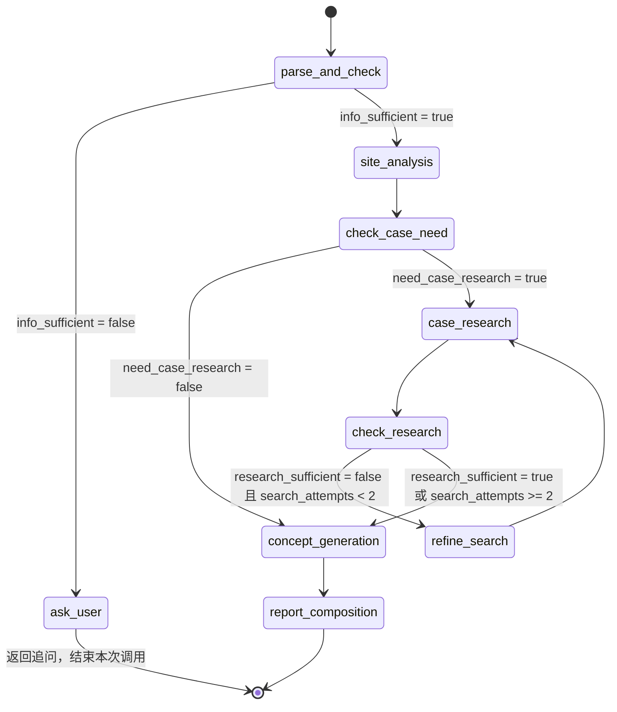
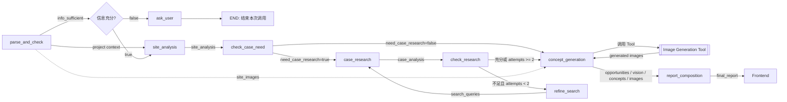

# Agent Architecture

## 1. 架构目标

项目前期研究 Agent 面向城市设计项目的前期设计阶段，通过 Agent 对任务状态进行判断，并调用不同的专业能力完成项目理解、场地分析、案例研究、设计机会识别、概念方向生成和研究报告组织。

架构设计重点解决以下问题：

1. Agent 如何根据当前任务状态决定下一步行动；
2. 专业能力如何以 Skill 的形式组织和复用；
3. 外部能力如何通过 Tool 接入；
4. Agent 如何保存任务状态和中间结果；
5. 如何通过条件路由实现案例研究的动态决策；
6. 如何限制循环次数，避免 Agent 无限制执行；
7. 如何在不增加 Graph 复杂度的情况下支持基于场地图片的概念意向图生成。

## 2. 架构原则

### 2.1 单 Agent、单 Graph

V1 采用单 Agent + 单 Graph 架构，不采用 Multi-Agent。

项目任务虽然包含多个专业环节，但各环节之间具有明确的先后关系，并共享同一项目上下文，因此使用一个主 Graph 进行任务编排即可。

Agent 通过不同 Node 调度专业 Skill 和 Tool，而不是为每个专业环节创建独立 Agent。

### 2.2 决策与执行分离

系统将“判断下一步做什么”和“具体完成专业任务”分开。

- **Agent / Graph**：负责整体任务编排和流程控制；
- **Node**：负责读取 State、执行当前任务、调用 Skill，并更新 State；
- **Skill**：负责完成具体专业任务；
- **Tool**：负责提供搜索、图像生成等外部执行能力。

核心关系为：

```text
Agent / Graph
      ↓
Node
什么时候执行什么任务
      ↓
Skill
专业任务具体怎么完成
      ↓
Tool
提供外部执行能力
```

其中，Decision Node 可以直接完成判断逻辑，不要求调用独立 Skill。

### 2.3 条件路由优先于固定流程

Agent 根据当前 State 判断下一步任务，因此 Graph 中显式保留关键 Decision Node，而不是将所有任务串联成固定流程。

例如：

```text
场地分析
    ↓
是否需要案例研究？
    ├── 否 → 概念方向生成
    └── 是 → 案例研究
```

案例研究也不是固定执行一次，而是根据研究结果判断是否需要继续：

```text
案例研究
    ↓
研究是否充分？
    ├── 是 → 概念方向生成
    └── 否 → 调整搜索方向
```

### 2.4 有限循环

Agent 允许根据执行结果进行有限次数的重新执行，但不允许无限循环。

V1 设置：

- 案例研究最多执行 2 轮；
- 概念方向最多自动重新生成 1 次；
- Tool API 的技术重试与 Agent 的业务循环相互独立；
- 超过业务循环限制后继续主流程，不再自动重复执行。

其中：

```text
案例研究循环
→ Graph 层控制

概念重新生成
→ Concept Generation Skill 内部控制

Tool API Retry
→ Tool 层控制
```

三者职责不同，不混合处理。

### 2.5 State 驱动

Agent 的关键决策必须基于显式 State 字段，而不是依赖隐式上下文。

例如：

```text
info_sufficient
→ 是否进入 site_analysis

need_case_research
→ 是否进入 case_research

research_sufficient + search_attempts
→ 是否继续案例研究
```

State 负责记录任务当前已知信息、阶段结果和流程控制状态，不承担专业任务执行逻辑。

## 3. 分层架构

系统整体采用：

```text
┌─────────────────────────────────────────┐
│              Agent / Graph              │
│   State · 编排 · Decision · Routing     │
└───────────────────┬─────────────────────┘
                    │
┌───────────────────▼─────────────────────┐
│                  Node                   │
│      State Read · Skill Call · Update   │
└───────────────────┬─────────────────────┘
                    │
┌───────────────────▼─────────────────────┐
│                 Skills                  │
│ 场地分析 · 案例研究 · 概念生成 · 报告组织 │
└───────────────────┬─────────────────────┘
                    │
┌───────────────────▼─────────────────────┐
│                  Tools                  │
│       Web Search · Image Generation     │
└─────────────────────────────────────────┘
```

### 3.1 Agent / Graph

负责整个任务生命周期：

- 接收任务输入；
- 管理统一 State；
- 调度不同 Node；
- 根据 State 进行条件路由；
- 控制业务循环次数；
- 处理 Human-in-the-Loop；
- 最终结束任务。

Graph 不直接实现城市设计专业能力。

### 3.2 Node

Node 是 Graph 中的执行单元。

Node 主要承担三类职责：

**输入处理：**

```text
parse_and_check
ask_user
```

**决策：**

```text
check_case_need
check_research
refine_search
```

**专业任务调度：**

```text
site_analysis
case_research
concept_generation
report_composition
```

对于专业任务 Node，其基本执行方式为：

```text
读取 State
    ↓
调用 Skill
    ↓
获取结构化结果
    ↓
更新 State
```

Tool 不直接读写 Agent State。

### 3.3 Skill

Skill 是可复用的专业能力模块，用于描述一个完整专业任务应该如何完成。

V1 设置四个核心 Skill：

| Skill | 核心职责 |
|---|---|
| Site Analysis Skill | 项目定位分析、场地条件分析、SWOT |
| Case Research Skill | 案例检索策略、案例搜索、筛选与分析 |
| Concept Generation Skill | 设计机会识别、目标愿景、概念方向、质量检查和意向图生成 |
| Report Composition Skill | 汇总研究结果并形成最终研究报告 |

其中：

```text
项目原始信息解析
→ parse_and_check Node

项目定位专业分析
→ Site Analysis Skill
```

避免重复承担“项目理解”职责。

SWOT 属于场地分析的一部分，不单独拆分 Skill。

Concept Generation Skill 内部包含：

```text
设计机会识别
    ↓
目标愿景提炼
    ↓
概念方向生成
    ↓
概念质量检查
    ↓
必要时重新生成一次
    ↓
意向图生成
```

概念质量检查属于 Skill 内部执行逻辑，不在 Graph 中增加独立 Node。

### 3.4 Tool

Tool 提供 Agent 和 Skill 本身不具备的外部执行能力。

V1 设置两个主要 Tool：

| Tool | 用途 |
|---|---|
| Web Search Tool | 搜索城市设计案例及外部资料 |
| Image Generation Tool | 根据概念方向生成意向图，支持 text2img，并在 Provider 支持时使用场地图片进行参考图生成 |

项目地图、卫星图、现状照片和规划分析图由多模态模型直接读取，V1 不单独设计 Image Analysis Tool。

Image Generation Tool 对上层提供统一接口。

不同图像 Provider 的 API 差异由 Tool 层处理，具体 Provider Adapter 设计在 `tools.md` 中定义。

## 4. Agent Graph

### 4.1 总体流程

V1 Graph 包含 9 个 Node：



主流程为：

```text
parse_and_check
      ↓
site_analysis
      ↓
check_case_need
      ├── 不需要案例
      │       ↓
      │ concept_generation
      │
      └── 需要案例
              ↓
         case_research
              ↓
         check_research
              ├── 不充分且 attempts < 2
              │          ↓
              │    refine_search
              │          ↓
              │    case_research
              │
              └── 充分 / attempts >= 2
                         ↓
                 concept_generation
                         ↓
                 report_composition
```

案例研究最多执行 2 轮。

业务语义上，用户补充后重新进入 `parse_and_check`；实际 Graph 为 `ask_user → END`，前端合并补充信息后重新调用 `graph.invoke()`，不建立图内返回边。

概念重新生成属于 Concept Generation Skill 内部逻辑，因此不体现在 Graph 循环中。

### 4.2 数据流



其中：

```text
Image Generation Tool
```

不是 Graph Node。

实际调用关系为：

```text
concept_generation Node
        ↓
Concept Generation Skill
        ↓
Image Generation Tool
        ↓
Concept Generation Skill
        ↓
concept_generation Node
        ↓
更新 images
```

Tool 不直接将结果写入 State，也不直接连接 `report_composition`。

## 5. Node 定义

### 5.1 parse_and_check

**职责：**理解用户输入，提取项目基础信息，并判断当前资料是否达到继续执行场地分析的最低要求。

主要处理：

- 读取项目描述；
- 读取场地图片；
- 提取项目背景；
- 提取项目位置；
- 提取已知规划条件；
- 提取设计要求；
- 形成场地图片初步描述；
- 判断关键资料是否缺失。

**读 State：**

```text
user_input
site_images
```

**写 State：**

```text
project_background
location
planning_conditions
client_requirements
site_image_description

info_sufficient
missing_critical
missing_optional
followup_question
```

如果：

```text
info_sufficient = false
```

则路由至：

```text
ask_user
```

如果：

```text
info_sufficient = true
```

则进入：

```text
site_analysis
```

### 5.2 ask_user

**职责：**针对当前缺失的关键资料向用户提出补充问题。

仅针对会阻止后续任务继续执行的关键条件进行询问，不要求用户补充所有非必要信息。

**读 State：**

```text id="qs9ur7"
missing_critical
missing_optional
followup_question
```

`followup_question` 由 `parse_and_check` 根据当前缺失信息生成。

`ask_user` 本身不修改 `user_input`，也不负责将用户补充内容写入 State。用户补充信息由前端接收，并与原始任务输入合并。

**写 State：**

V1 不新增 State 字段。

`ask_user` 的主要职责是将已有的 `followup_question` 返回前端。

**图语义：**

从业务流程语义上：

```text id="pp89gn"
ask_user
    ↓
用户补充信息
    ↓
parse_and_check
```

用户补充信息后，需要重新进入 `parse_and_check`，再次判断当前资料是否达到继续执行的最低要求。

因此，架构图中可以使用：

```text id="z882gg"
ask_user → parse_and_check
用户补充信息（前端重新调用）
```

表示这一业务语义。

**实现说明：**

V1 不使用 LangGraph `interrupt` / Checkpoint，因此不会在同一次 Graph execution 中暂停等待用户输入，也不在 Graph 中建立实际的：

```text id="8qd70s"
ask_user → parse_and_check
```

执行边。

实际执行方式为：

```text id="9rbyag"
ask_user 返回追问
        ↓
当前 Graph execution 结束
        ↓
前端展示 followup_question
        ↓
用户补充信息
        ↓
前端合并原始输入与补充信息
        ↓
重新调用 graph.invoke()
        ↓
从 parse_and_check 开始新的 execution
```

因此：

```text id="j9x4nk"
架构图
→ 表达业务流程上的“重新解析”

实际 Graph
→ ask_user → END

前端
→ 负责用户补充信息和下一次 graph.invoke()
```

这种方式保持了业务流程表达的完整性，同时避免 V1 引入 `Interrupt`、Checkpointer 和执行恢复机制。

如果用户选择不继续补充，则当前任务结束，不再重新调用 Graph。

### 5.3 site_analysis

**职责：**基于结构化项目条件和场地视觉信息完成项目定位分析和场地条件分析。

**调用：**

```text
Site Analysis Skill
```

**读 State：**

```text
project_background
location
planning_conditions
client_requirements
site_image_description
site_images
```

主要分析：

- 项目定位；
- 区位条件；
- 功能条件；
- 景观及生态资源；
- 公共空间；
- 道路及主要界面；
- 空间关系；
- SWOT；
- 场地综合判断。

**写 State：**

```text
site_analysis
```

V1 主要完成定性分析，不进行精确 GIS 测算。

### 5.4 check_case_need

**职责：**根据项目定位和场地分析结果判断是否需要开展外部案例研究，并确定研究方向。

用户指定研究方向或案例作为任务初始输入或重新发起任务时的输入，统一并入 `user_input`，解析出的要求可保存在既有 `client_requirements` 中。运行过程中不暂停等待人工确认或修改研究方向。

这是 Agent 的核心 Decision Node 之一。

**读 State：**

```text
site_analysis
```

判断依据包括：

- 当前项目是否存在明显的类型参考需求；
- 项目定位是否需要借鉴同类型项目；
- 场地是否存在特殊资源处理问题；
- 当前设计问题是否需要外部案例作为参考；
- 案例研究是否能够明显增加后续概念生成的信息价值。

同时读取既有 `client_requirements`（`str | None`），以考虑用户指定的研究方向或案例；不新增 State 字段。

**写 State：**

```text
need_case_research
research_direction
```

例如：

```json
{
  "need_case_research": true,
  "research_direction": [
    "滨水公共空间",
    "TOD 商业中心"
  ]
}
```

如果：

```text
need_case_research = false
```

则直接进入：

```text
concept_generation
```

如果：

```text
need_case_research = true
```

则进入：

```text
case_research
```

### 5.5 case_research

**职责：**根据已经确定的研究方向完成案例检索和分析。

**调用：**

```text
Case Research Skill
        ↓
Web Search Tool
```

**读 State：**

```text
site_analysis
research_direction
search_queries
```

案例研究主要包括：

- 生成或读取搜索关键词；
- 搜索相关案例；
- 筛选具有参考价值的案例；
- 提取案例事实；
- 分析案例与当前项目之间的关联；
- 提炼可借鉴的空间策略。

Case Research Skill 返回：

```text
search_queries
filtered_cases
case_analysis
```

`case_research` Node 在 Skill 执行成功后负责更新：

```text
search_attempts
```

例如：

```python
result = research_cases(...)

return {
    **result,
    "search_attempts": state.get("search_attempts", 0) + 1,
}
```

因此：

```text
search_attempts
```

属于 Graph 循环控制状态，不属于 Case Research Skill 的专业输出。

**写 State：**

```text
search_queries
filtered_cases
case_analysis
search_attempts
```

案例研究不是简单返回搜索结果，而是需要将外部案例与当前项目建立明确关联。

### 5.6 check_research

**职责：**判断当前案例研究是否已经满足概念生成所需的信息要求。

**读 State：**

```text
research_direction
filtered_cases
case_analysis
site_analysis
search_attempts
```

其中核心判断依据为：

```text
research_direction
filtered_cases
case_analysis
```

`site_analysis` 作为项目背景上下文。

判断内容包括：

- 案例是否覆盖主要研究方向；
- 案例与当前项目是否具有明确相关性；
- 是否能够提炼有效空间策略；
- 是否存在明显研究缺口。

**写 State：**

```text
research_sufficient
research_gaps
```

如果：

```text
research_sufficient = true
```

则进入：

```text
concept_generation
```

如果：

```text
research_sufficient = false
且
search_attempts < 2
```

则进入：

```text
refine_search
```

如果：

```text
research_sufficient = false
且
search_attempts >= 2
```

则停止继续案例研究，基于已有结果进入：

```text
concept_generation
```

### 5.7 refine_search

**职责：**根据当前案例研究中仍存在的信息缺口调整下一轮研究策略。

**读 State：**

```text
research_direction
search_queries
research_gaps
search_attempts
```

主要调整：

- 搜索关键词；
- 案例类型；
- 研究角度；
- 参考对象；
- 搜索范围。

**写 State：**

```text
search_queries
```

该 Node 只会在：

```text
research_sufficient = false
且
search_attempts < 2
```

时通过 Conditional Routing 进入。

完成搜索策略调整后，重新进入：

```text
case_research
```

是否继续案例研究，以及是否达到最大研究轮次，由 `check_research` 后的 Conditional Routing 统一判断。

`refine_search` 不再重复进行最大轮次判断。

该 Node 属于 Agent 流程控制逻辑，不单独设计 Skill。

### 5.8 concept_generation

**职责：**基于项目分析和案例研究结果识别设计机会，形成目标愿景和多个概念方向，并生成对应的视觉参考图。

**读 State：**

- `project_background`
- `client_requirements`
- `site_analysis`
- `case_analysis`
- `site_images`（可选，用于支持基于场地图片的意向图生成）

**写 State：**

- `opportunities`
- `vision`
- `concepts`
- `images`

**调用：**

```text
Concept Generation Skill
```

核心过程：

```text
场地条件
+
案例研究
    ↓
设计机会识别
    ↓
目标愿景提炼
    ↓
概念方向生成
    ↓
概念质量检查
    ↓
意向图生成
```

默认生成 2–3 个具有明显差异的概念方向。

每个方向至少包含：

- 方向名称；
- 核心概念；
- 对应设计机会；
- 空间组织逻辑；
- 主要空间策略；
- 与场地条件的关系；
- 可参考案例。

概念质量检查由 Concept Generation Skill 内部完成。

如果生成结果不满足最低质量要求，Skill 最多自动重新生成 1 次。

第二次生成后直接返回当前结果，不再继续循环；`quality_check` 只存在于 Skill 内部，不进入 State。

该过程属于 Skill 内部逻辑，不形成额外 Graph Node 或 Graph 循环。

概念方向生成完成后，Concept Generation Skill 默认尝试调用：

```text
Image Generation Tool
```

生成对应视觉参考图。

V1 不增加“是否生成意向图”的任务级 State 字段；生成失败时允许 `images` 为空或部分成功，继续生成报告。

**图像生成模式：**

| 模式 | 说明 | 默认 |
|---|---|---|
| `text2img` | 根据项目条件、场地分析和概念方向构建文本 Prompt 生成意向图 | 默认 |
| `img2img` | 在文本 Prompt 基础上，以 `site_images` 作为视觉参考生成意向图 | 可选 |

图像生成模式由 Concept Generation Skill 根据系统配置、`site_images` 是否存在以及当前 Image Generation Provider 的能力确定。

基本逻辑：

```text
USE_IMG2IMG = true
+
site_images 存在
+
当前 Provider 支持参考图生成
        ↓
img2img

否则
        ↓
text2img
```

当 img2img 条件不满足时，自动回退至：

```text
text2img
```

不阻断当前 Agent 流程。

生成结果写入：

```text
images
```

每条结果记录：

```text
concept_name
image_url
prompt
mode
reference_images
```

其中：

- `mode`：记录本次实际使用的 `text2img` 或 `img2img`；
- `reference_images`：记录本次实际使用的场地参考图，`text2img` 时为空列表。

图像生成的 Prompt 构建、参考图使用和模式选择逻辑由 Concept Generation Skill 定义。

不同 Image Generation Provider 的具体参数映射由 Image Generation Tool 负责。

`Image Generation Tool` 不作为独立 Graph Node，也不直接读写 Agent State。

### 5.9 report_composition

**职责：**汇总前序阶段已经产生的结构化结果，形成最终研究报告。

**调用：**

```text
Report Composition Skill
```

**读 State：**

```text
project_background
location
planning_conditions
client_requirements

site_analysis
case_analysis

opportunities
vision
concepts
images
```

报告默认包含：

```text
项目理解
    ↓
场地条件分析
    ↓
案例研究
    ↓
设计机会识别
    ↓
目标愿景
    ↓
概念方向
    ↓
空间意向图
```

如果当前任务没有执行案例研究，则可以省略对应章节。

Report Composition Skill 不重新执行核心专业分析，而负责：

```text
组织
+
压缩
+
表达
+
来源整理
```

**写 State：**

```text
final_report
```

最终输出：

```text
Markdown
```

## 6. State Design

Agent 使用统一 `AgentState` 保存任务上下文、中间结果和必要的流程控制状态。

V1 State 主要包括：

```text
# User Input
user_input
site_images

# Project Understanding
project_background
location
planning_conditions
client_requirements
site_image_description

# Information Check
info_sufficient
missing_critical
missing_optional
followup_question

# Site Analysis
site_analysis

# Case Research
need_case_research
research_direction
search_queries
filtered_cases
case_analysis
research_sufficient
research_gaps
search_attempts

# Concept Generation
opportunities
vision
concepts
images

# Final Output
final_report
```

其中：

```text
images
```

除图片结果外，还记录：

```text
mode
reference_images
```

用于追踪实际图像生成方式。

`USE_IMG2IMG`、`REFERENCE_STRENGTH` 等系统配置不进入 Agent State。

State 的核心作用是：

- 保存任务上下文；
- 在不同 Node 之间传递结果；
- 支持 Conditional Routing；
- 支持有限循环；
- 支持过程调试和 Evaluation。

详细字段类型、结构和状态更新规则在：

```text
state-design.md
```

中定义。

## 7. Conditional Routing

Graph 中主要存在三个条件路由位置。

### 7.1 信息充分性判断

```text
parse_and_check
      ↓
info_sufficient?
   ┌─────┴─────┐
   否          是
   ↓           ↓
ask_user  site_analysis
```

判断字段：

```text
info_sufficient
```

### 7.2 是否需要案例研究

```text
check_case_need
        ↓
need_case_research?
    ┌──────┴──────┐
    否            是
    ↓             ↓
concept     case_research
```

判断字段：

```text
need_case_research
```

### 7.3 案例研究是否满足要求

```text
check_research
       ↓
research_sufficient?
       │
   ┌───┴────────────────────┐
   │                        │
  true                    false
   ↓                        ↓
concept_generation   search_attempts < 2?
                          ┌──┴──┐
                          是    否
                          ↓     ↓
                    refine_search
                          ↓
                    case_research
                                concept_generation
```

实际逻辑为：

```text
research_sufficient = true
→ concept_generation

research_sufficient = false
AND
search_attempts < 2
→ refine_search

research_sufficient = false
AND
search_attempts >= 2
→ concept_generation
```

因此最大研究轮次判断集中在 Conditional Routing 中，不由 `refine_search` 再次决定。

## 8. Agent、Node、Skill 与 Tool 的职责边界

| 层级 | 核心问题 | 主要职责 |
|---|---|---|
| Agent / Graph | 下一步做什么？ | State 管理、任务编排、条件路由、业务循环控制 |
| Node | 当前阶段执行什么？ | 读取 State、执行判断或调用 Skill、更新 State |
| Skill | 专业任务怎么完成？ | 封装专业任务的方法、推理和执行逻辑 |
| Tool | 如何获得外部能力？ | 搜索、图像生成、外部 API 调用 |

核心关系：

```text
State
  ↓
Node
  ↓
Skill
  ↓
Tool
```

执行完成后：

```text
Tool Result
    ↓
Skill Result
    ↓
Node
    ↓
State Update
```

Tool 不直接读写 State。

## 9. Human-in-the-Loop

Agent 负责前期研究和方向生成，但不替代设计人员的最终专业判断。

### 9.1 用户参与方式

V1 保留以下人工介入方式。

**信息补充：**

当关键项目资料不足时，由 `ask_user` 请求用户补充项目描述、场地位置或场地图片。

V1 的信息补充采用应用层重新调用方式实现，不使用 LangGraph `interrupt` / Checkpoint。Interrupt 机制仅作为后续需要在同一次 Graph execution 中暂停和恢复任务时的扩展方案。

**案例指定：**

用户可以在任务初始输入或重新发起任务时提供希望重点参考的项目，统一并入 `user_input`，作为案例研究输入的一部分。

**研究方向调整：**

用户可以在任务初始输入或重新发起任务时提供研究方向。V1 运行过程中不暂停等待人工确认或修改 Agent 生成的研究方向，也不增加对应 Graph Node。

**概念选择：**

Agent 输出 2–3 个概念方向，由设计人员判断后续采用方向。

V1 中概念选择属于报告输出后的人工决策，不设置独立 Graph Node。

如果后续版本需要：

```text
生成概念
    ↓
人工选择
    ↓
基于选定方向继续深化
```

可以再通过：

```text
LangGraph Interrupt
+
Checkpoint
```

将该人工决策正式接入执行流程。

### 9.2 人机职责

```text
Agent
├── 输入理解
├── 场地分析
├── 案例研究
├── 设计机会识别
├── 概念方向生成
├── 意向图生成
└── 研究报告组织


Human
├── 补充关键项目条件
├── 初始输入或重新发起任务时指定案例
├── 初始输入或重新发起任务时指定研究方向
└── 判断和选择概念方向
```

V1 的核心原则：

> Agent 负责扩大研究范围、组织信息和生成方向，设计人员负责最终专业判断。

## 10. Error Handling

### 10.1 输入资料不足

当关键项目资料缺失时：

```text
parse_and_check
        ↓
info_sufficient = false
        ↓
ask_user
```

Agent 不应在缺少最低必要条件时直接进入完整场地分析和概念生成。

### 10.2 Web Search Tool 调用失败

Web Search 的技术错误与 Agent 的案例研究业务循环分开处理。

如果出现瞬时 API 错误：

```text
Web Search Tool
      ↓
有限技术重试
```

如果 Tool 最终仍不可用：

```text
Case Research Skill
      ↓
返回当前已有结果
+
保留研究限制
```

是否再次执行案例研究，仍由：

```text
check_research
+
Conditional Routing
```

决定。

因此：

```text
Tool Retry
≠
Case Research Loop
```

### 10.3 案例研究不足

案例研究最多执行 2 轮。

如果第一轮研究不足：

```text
check_research
      ↓
refine_search
      ↓
case_research
```

如果第二轮仍不充分：

```text
search_attempts >= 2
      ↓
停止研究循环
      ↓
concept_generation
```

后续概念生成基于当前已有的场地信息和案例研究结果继续执行。

### 10.4 概念生成未达到预期质量

Concept Generation Skill 内部执行概念质量检查。

如果第一次生成未达到最低要求：

```text
第一次生成
    ↓
内部检查
    ↓
重新生成一次
```

最多重新生成 1 次。

第二次生成后，无论是否达到预期质量，都：

```text
直接返回第二次生成的当前结果
```

不再继续自动循环。

V1 不将内部 `quality_check` 结果写入 Agent State。

### 10.5 Image Generation 失败

意向图属于概念表达增强能力，不是概念生成成功的必要条件。

如果 Image Generation Tool 调用失败：

```text
保留 concepts
+
images 为空或部分成功
+
继续 report_composition
```

图像生成失败不应阻断完整研究报告输出。

### 10.6 img2img 不可用

如果：

```text
USE_IMG2IMG = true
```

但出现以下情况：

- 没有有效 `site_images`；
- 当前 Provider 不支持参考图生成；
- 参考图调用失败；

则自动回退至：

```text
text2img
```

不改变 Agent Graph。

## 11. V1 Scope

V1 只实现支撑核心 Agent 闭环所必需的能力。

### 11.1 P0

```text
项目资料输入
    ↓
项目基础理解
    ↓
场地条件分析
    ↓
案例研究决策
    ↓
案例搜索与分析
    ↓
设计机会识别
    ↓
概念方向生成
    ↓
研究报告生成
```

### 11.2 P1

```text
意向图生成
概念质量自动检查
案例研究有限循环
Human-in-the-Loop
img2img 场地参考生成
```

### 11.3 P2

```text
专业案例知识库
RAG
更复杂空间分析
GIS 自动分析
基于选定概念的继续深化
Multi-Agent
长期记忆
```

V1 不引入：

- GIS 自动分析；
- Multi-Agent；
- 独立 RAG 系统；
- 复杂空间计算；
- 精确设计效果图生成。

V1 聚焦于：

> Agent 状态判断、专业能力编排、案例研究和概念方向生成的完整闭环。

## 12. 技术实现映射

### 12.1 LangGraph 对应关系

使用 LangGraph 实现 Graph 和 State 管理。

| Agent 架构 | LangGraph / Python 实现 |
|---|---|
| Agent / Graph | `StateGraph` |
| State | `AgentState` |
| Node | Graph Node |
| Conditional Routing | Conditional Edge |
| 有限业务循环 | Conditional Edge + Counter |
| Human-in-the-Loop | ask_user → END；前端补充后重新调用 graph.invoke()，V1 不使用 Interrupt / Checkpoint |
| Skill | Python Module |
| Tool | Tool Function / API Wrapper |

### 12.2 Graph 组装示例

```python
from langgraph.graph import StateGraph, START, END

from src.agent.state import AgentState
from src.agent.routes import (
    route_info,
    route_case_need,
    route_research,
)

from src.agent.nodes import (
    parse_and_check,
    ask_user,
    site_analysis_node,
    check_case_need,
    case_research_node,
    check_research,
    refine_search,
    concept_generation_node,
    report_composition_node,
)


builder = StateGraph(AgentState)


# Nodes
builder.add_node("parse_and_check", parse_and_check)
builder.add_node("ask_user", ask_user)
builder.add_node("site_analysis", site_analysis_node)
builder.add_node("check_case_need", check_case_need)
builder.add_node("case_research", case_research_node)
builder.add_node("check_research", check_research)
builder.add_node("refine_search", refine_search)
builder.add_node("concept_generation", concept_generation_node)
builder.add_node("report_composition", report_composition_node)


# Entry
builder.add_edge(START, "parse_and_check")


# Conditional Edge A: information sufficiency
builder.add_conditional_edges(
    "parse_and_check",
    route_info,
    {
        "site_analysis": "site_analysis",
        "ask_user": "ask_user",
    },
)

# ask_user 输出追问后，图执行结束。
# V1 不使用图内 interrupt，用户补充信息后由前端重新发起 graph.invoke()，
# 从 parse_and_check 开始执行。
#
# 图语义上 ask_user 应回到 parse_and_check，但实现上不建立图内边：
# builder.add_edge("ask_user", "parse_and_check")  # V1 不使用
builder.add_edge("ask_user", END)


# Main path
builder.add_edge("site_analysis", "check_case_need")


# Conditional Edge C: case research need
builder.add_conditional_edges(
    "check_case_need",
    route_case_need,
    {
        "case_research": "case_research",
        "concept_generation": "concept_generation",
    },
)


# Case research
builder.add_edge("case_research", "check_research")


# Conditional Edge B: research sufficiency
builder.add_conditional_edges(
    "check_research",
    route_research,
    {
        "refine_search": "refine_search",
        "concept_generation": "concept_generation",
    },
)

builder.add_edge("refine_search", "case_research")


# Final path
builder.add_edge("concept_generation", "report_composition")
builder.add_edge("report_composition", END)


graph = builder.compile()
```

其中：

```text
route_research
```

统一处理：

```text
research_sufficient
+
search_attempts
```

不在 `refine_search` 中重复控制最大轮次。

### 12.3 代码结构

```text
src/
├── __init__.py
├── config.py
│
├── agent/
│   ├── __init__.py
│   ├── state.py
│   ├── nodes.py
│   ├── routes.py
│   └── graph.py
│
├── skills/
│   ├── __init__.py
│   ├── site_analysis.py
│   ├── case_research.py
│   ├── concept_generation.py
│   └── report_composition.py
│
├── tools/
│   ├── __init__.py
│   ├── web_search.py
│   └── image_generation.py
│
├── schemas/
│   ├── __init__.py
│   ├── site_info.py
│   ├── case.py
│   └── concept.py
│
├── prompts/
│   ├── parse_input.md
│   ├── analyze_site.md
│   ├── research_cases.md
│   ├── identify_opportunities.md
│   ├── generate_concepts.md
│   └── compose_report.md
│
└── frontend/
    ├── __init__.py
    └── app.py
```

V1 不创建：

```text
schemas/report.py
```

因为最终报告当前直接以 Markdown String：

```text
final_report: str
```

保存。

### 12.4 配置层

系统运行参数由：

```text
src/config.py
```

统一管理。

当前与架构直接相关的配置包括：

```text
MAX_SEARCH_ATTEMPTS = 2
MAX_CONCEPT_REGENERATIONS = 1

USE_IMG2IMG = false
# 参考强度非 V1 强制配置，Stage 5 按 Qwen Image 实际 API 决定
```

其中：

```text
MAX_SEARCH_ATTEMPTS
```

用于 Graph 业务循环控制；

```text
MAX_CONCEPT_REGENERATIONS
```

用于 Concept Generation Skill 内部质量循环；

```text
USE_IMG2IMG
REFERENCE_STRENGTH
```

用于图像生成策略。

配置属于系统运行策略，不进入 Agent State。

具体 Tool Provider 和参数适配方式在 `tools.md` 中定义。

## 13. Architecture Summary

项目前期研究 Agent 的核心不是将城市设计全过程自动化，而是建立一个能够根据任务状态自主决定下一步研究行动的 Agent。

核心运行逻辑：

```text
理解项目输入
    ↓
分析场地条件
    ↓
判断是否需要案例研究
    ↓
必要时进行案例研究
    ↓
判断研究是否充分
    ↓
必要时调整研究方向并重新搜索
    ↓
识别设计机会
    ↓
形成项目愿景
    ↓
生成多个概念方向
    ↓
生成视觉参考
    ↓
组织研究结果
    ↓
输出研究报告
```

整体架构关系为：

```text
                    State
                      ↑
                      │
                Agent / Graph
                      │
        ┌─────────────┼─────────────┐
        │             │             │
     Decision      Execution     Loop Control
        │             │
 Conditional       Node
   Routing            │
                    Skill
                      │
                     Tool
```

各层核心职责为：

```text
Agent / Graph
→ 管理任务生命周期和流程

Node
→ 读取 State、执行当前任务并更新 State

Skill
→ 封装完整专业能力

Tool
→ 提供外部执行能力

State
→ 保存任务上下文、阶段结果和必要控制状态

Conditional Edge
→ 根据 State 决定下一步流程
```

最终形成：

> **State 驱动状态管理，Agent / Graph 负责任务编排，Node 负责执行与状态更新，Skill 封装专业能力，Tool 提供外部能力，Conditional Edge 实现动态路由，有限循环支持结果驱动的迭代。**
