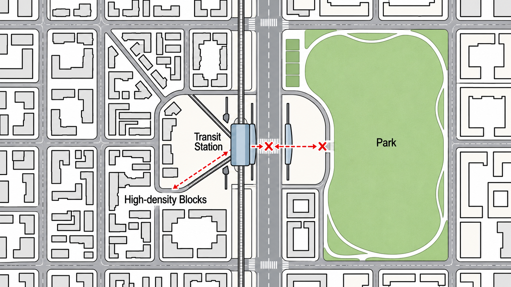

# Case 02 Demo

## Input

项目位于轨道交通换乘站周边，研究范围约 60 公顷。核心站点位于场地中部，周边现状以商业、办公、居住及公交设施为主。

项目目标是提升站城一体化水平，优化步行系统和公共空间，并形成高强度混合功能开发。

已上传场地分析图，请结合图片识别道路、站点、开放空间及主要空间联系，完成场地分析，并结合类似 TOD 案例提出概念方向。

固定输入场地分析图（原 Dataset 资产）：

## Agent Route

`parse_and_check → site_analysis → check_case_need → case_research → check_research → refine_search → case_research → check_research → concept_generation → report_composition → END`

## Why This Case

该案例展示上传图片与文字信息共同参与场地理解，再将道路阻隔、站点与公园关系转为设计机会和差异化概念。人工抽检的 Site Analysis 与 Groundedness 均为 5 分；适合展示多模态前期研究能力。

## Key Output

以下直接提取最终 Regression 的既有 final_report；未重生成、未修订专业判断或案例事实。原报告正文与来源链接保持不变。

本次正式 Eval 因额度控制关闭生成图片，因此展示的是研究与概念文本。报告为前期研究输出，其中推理、策略与政策适用性仍需结合实际场地和专业审阅确认；来源链接保留，不代表全文已经独立核验。

---

# 轨道交通换乘站周边区域更新研究报告

## 1. 项目理解与背景

### 1.1 项目概况
本项目为**轨道交通换乘站周边区域更新研究**，研究范围约 **60公顷**。核心站点位于场地中部，旨在提升站城一体化水平，优化步行系统和公共空间，并形成高强度混合功能开发。

*   **地理位置**：未提供具体城市名称或精确地址，仅描述为轨道交通换乘站周边。
*   **现状功能**：以商业、办公、居住及公交设施为主。
*   **交通条件**：轨道交通换乘站位于场地几何中心，是区域交通转换的核心节点。

### 1.2 任务目标
结合上传的场地分析图识别道路、站点、开放空间及主要空间联系，完成场地分析，并结合类似TOD案例提出概念方向。

---

## 2. 场地分析结论

基于对60公顷研究范围的深入剖析，场地呈现典型的“西城东园”格局，具备TOD更新的基础条件，但也面临显著的空间割裂问题。

### 2.1 区位与环境条件
*   **交通核心**：轨道交通线路垂直穿过场地中心，换乘站位于核心位置，交通可达性极高。
*   **城市界面**：
    *   **西侧**：高密度城市建成区，呈现典型的高密度网格状或围合式街区布局，建筑边界清晰，形成紧凑的城市肌理。
    *   **东侧**：大型自然生态空间（公园），拥有大面积连续绿色空间，边界较为自由有机。
*   **景观资源**：东侧公园提供稀缺的生态景观资源和休闲活动载体；站点与公园之间存在潜在的视觉通廊，但被道路阻断。

### 2.2 功能与空间痛点
*   **功能分布**：高密度街区集中在站点西侧，东侧主要为低密度的公园绿地。Transit Station作为人流集散中心，目前对东侧公园的辐射能力受限于过街条件。
*   **步行系统断裂**：
    *   **关键断点**：站点通往公园的主要步行轴线存在明显断裂（图中红色叉号所示），缺乏安全、舒适的过街设施。
    *   **人车冲突**：一条南北向主干道贯穿场地，构成主要的交通骨架，但也造成了东西向的物理分割，对东西向步行流形成干扰。
    *   **衔接不足**：现状公交设施与轨道交通衔接，但慢行系统（步行/骑行）与轨道站点的无缝连接不足，特别是向东通往公园的通道受阻。
*   **界面质量低下**：公园与城市建筑之间缺乏缓冲或过渡地带，直接相邻或存在硬隔离，城市硬质空间与自然软质空间之间的界面质量较低。

### 2.3 SWOT 分析摘要
*   **优势 (Strengths)**：极高的交通集聚效应；西侧高密度街区提供人口基数；东侧优质公园绿地资源；场地尺度适中便于整体改造。
*   **劣势 (Weaknesses)**：**站点与公园之间的关键步行联系被主干道切断**，存在严重安全隐患；东西两侧功能与景观差异巨大，区域割裂感强；现状步行系统不完善；公共空间缺乏活力节点。
*   **机会 (Opportunities)**：通过立体化过街设施打通“最后一公里”；利用公园边缘植入复合功能激活边界；借鉴TOD案例提高土地集约利用效率；串联破碎步行网络。
*   **威胁 (Threats)**：过度拥挤加剧环境压力；生硬处理界面引发居民担忧；主干道改造工程难度大；缺乏长期运营维护机制。

### 2.4 分析总结
本项目地处轨道交通换乘站核心，西拥高密度城市肌理，东接大型生态公园。当前最大痛点在于**站点与公园之间的东西向步行联系被主干道物理阻断**，导致优质景观资源无法有效服务于密集居住人群，站城一体化程度不足。未来应聚焦于“缝合”这一关键断裂带：一方面通过工程与景观设计手段重建安全、舒适、有吸引力的步行通廊；另一方面在公园边缘植入复合功能，软化城市与自然界面。

---

## 3. 案例研究与依据

本研究筛选了三个相关度较高的案例/导则，用于支撑空间策略与技术可行性分析。需注意现有资料多为宏观规划或概念方案，缺乏部分微观技术细节。

### 3.1 城市更新背景下，TOD多元社区的介入的策略
*   **来源**：[建筑档案](https://www.jzda001.com/index/index/details?type=1&id=7794)
*   **地点**：中国南宁、南京
*   **类型**：TOD立体多维社区开发
*   **相关性**：高。该案例直接涉及轨道交通站点与城市公共空间及商业/居住功能的深度融合，提出的“缝合”策略直接回应了解决站点与公园/绿地之间物理阻隔的需求。
*   **空间策略**：
    *   构建垂直多维度空间体系，利用立体交通盒子穿插于建筑形态中。
    *   以商业大底盘粘合功能，将住宅融合其中，形成开放共融的城市级社区。
    *   通过轴线延伸和细部缝合，实现人行步道、公共景观资源与地铁站点的深度融合。
*   **证据局限**：
    *   来源侧重设计理念与方案效果，缺乏具体的工程实施数据或后期运营评估。
    *   具体项目规模、建成年份及详细技术指标未在片段中明确。
    *   主要聚焦于大型TOD综合体内部的空间缝合，对于如何具体处理与外部大型生态公园边界的软性过渡提及较少。

### 3.2 深圳市步行和自行车交通系统规划设计导则
*   **来源**：[深圳市规划和自然资源局](https://pnr.sz.gov.cn/ywzy/ghzs/zxcgh/gtghsjdz.pdf)
*   **地点**：中国深圳
*   **类型**：步行与自行车交通系统规划导则
*   **相关性**：中高。提供了针对高密度城市环境中慢行系统重构的具体技术标准，支撑了“缝合被主干道阻断的步行系统”的技术可行性分析。
*   **空间策略**：
    *   过街设施选型以平面为主、立体为辅，但在主干路及以上等级道路人车冲突严重时采用立体过街。
    *   核心步行片区内的人行天桥和地道必须设置自动扶梯和垂直电梯，实现无障碍连接。
    *   立体过街设施出入口应与地面主要人流集散位置一致，并预留人流集散用地。
    *   构建系统化的遮阳避雨体系，将沿街建筑挑檐与轨道站点出入口、立体过街设施有效衔接。
*   **证据局限**：
    *   此为地方性规划导则与技术标准，非具体建成案例，缺乏实际使用反馈和空间体验细节。
    *   标准规定了最小宽度和基本配置，但对于如何通过景观设计提升过街设施的吸引力等美学策略描述有限。
    *   未直接涉及大型公园与站点之间的长距离线性空间缝合策略。

### 3.3 北京石景山区首钢北SS00—1609 街区控制性详细规划
*   **来源**：[北京市石景山区政府](https://www.bjsjs.gov.cn/gongkai/zwgkpd/tzgg_1933/202608/P020260813331198289192.pdf)
*   **地点**：中国北京石景山（新首钢地区）
*   **类型**：轨道微中心与滨水空间一体化更新
*   **相关性**：中高。展示了如何将轨道交通站点与滨水生态资源进行一体化管控和功能混合，特别是强调了地下空间与站厅层的无缝衔接。
*   **空间策略**：
    *   构建轨道微中心立体化步行设施网络（地面+地下+空中），路网密度达到地面道路的1.2-1.5倍。
    *   鼓励周边地块地下空间与轨道站厅层无缝衔接。
    *   塑造层次丰富的滨水岸线，采用木栈道、退台公园等方式增加亲水活动空间。
    *   强化滨水空间与公共活动的联系，结合建筑景观一体化设计悬浮露台、栈桥等多元活力休憩空间。
*   **证据局限**：
    *   案例背景为新首钢工业区转型，其原有的工业肌理与任务中的常规城市-公园界面存在差异。
    *   片段主要提供规划条文和控制指标，缺乏对具体节点设计手法和空间氛围营造的详细图解。
    *   对于如何处理南北向主干道对东西向步行流的干扰，片段中未提供具体的工程或景观解决方案细节。

---

## 4. 研究缺口 (Research Gaps)

当前研究仍存在以下不足，需在后续深化阶段补充：

1.  **缺乏针对‘被主干道阻断的步行系统’的具体工程与景观设计案例**：现有资料多为宏观规划导则或概念方案，缺少关于立体过街设施（天桥/地道）如何具体解决人车冲突、优化断面设计以及提升通行舒适度的详细技术案例。
2.  **缺乏处理‘高密度居住区与大型生态公园界面融合’的成熟建成案例**：现有TOD案例多聚焦于站点内部或商业综合体的空间缝合，对于站点-公园这一特定长距离线性界面的软性过渡（如植被缓冲、视线通廊、边界软化）策略描述不足。
3.  **缺乏利用复合功能激活公园边缘地带并提升公共空间活力的具体操作案例**：现有分析未提供如何通过植入文化、体育或便民商业等混合功能来增强公园对城市居民的吸引力及开放性的实证研究。

---

## 5. 设计机会

基于场地痛点与案例启示，提炼出以下设计机会：

| 优先级 | 机会描述 | 依据 |
| :--- | :--- | :--- |
| **高** | **构建立体化慢行通廊，缝合站点与公园的物理断裂** | 基于场地分析中‘站点与公园之间的关键步行联系被主干道切断’的痛点，以及《深圳市步行和自行车交通系统规划设计导则》中关于主干路人车冲突严重时应采用立体过街设施的技术指引。 |
| **高** | **打造‘城市-自然’过渡性缓冲界面，激活公园边缘活力** | 依据场地分析中‘公园与城市建筑之间缺乏缓冲或过渡地带’的现状，结合案例中提出的‘以商业大底盘粘合功能’及‘细部缝合’策略。在公园东侧边界植入复合功能，软化硬质隔离。 |
| **中** | **建立地下空间无缝衔接网络，强化TOD集约开发效应** | 参考案例《北京石景山区首钢北SS00—1609 街区控制性详细规划》中‘鼓励周边地块地下空间与轨道站厅层无缝衔接’的经验，利用站点位于几何中心的区位优势，形成高效的内部集散体系。 |
| **中** | **重塑东西向视觉与景观通廊，恢复生态资源可达性** | 基于场地分析中‘站点与公园之间存在潜在的视觉通廊，但被道路阻断’的条件，借鉴案例中‘通过轴线延伸...实现人行步道、公共景观资源与地铁站点的深度融合’的手法。 |

---

## 6. 愿景 (Vision)

*   **主题**：**缝合·共生：站城一体化的绿色枢纽社区**
*   **定位**：高密度城市肌理与大型生态绿地高效融合的TOD更新示范区
*   **核心目标**：消除站点与公园间的物理阻隔，构建安全、舒适、连续的步行系统，实现交通、功能、景观与人的和谐共生
*   **空间理念**：以‘立体缝合’为核心策略，通过垂直维度（地下连廊、空中天桥）重构慢行网络，并在东西向主轴线上营造从城市硬质空间到自然软质空间的渐变过渡界面，形成开放共享的城市客厅与生态绿肺互动格局

---

## 7. 概念 (Concepts)

### 7.1 概念一：立体缝合：垂直微枢纽与空中连廊网络

*   **核心理念**：以“立体化交通盒子”为核心策略，通过地下、地面、空中三个维度的立体连接体系，彻底解决主干道对东西向步行流的物理切割。重点打造集换乘、商业、景观于一体的复合式过街设施，将站点与公园直接串联，实现“站城一体化”的高效流动。
*   **对应机会**：
    *   构建立体化慢行通廊，缝合站点与公园的物理断裂
    *   利用站点几何中心优势，强化地下空间无缝衔接
*   **空间策略**：构建‘垂直穿透+水平延伸’的空间骨架。在主干道阻断处设置大型立体交通枢纽（类似案例中的‘交通盒子’），内部整合自动扶梯、电梯及无障碍设施，外部结合商业界面形成活力节点。向西通过地下通道连接高密度街区，向东通过空中连廊或景观天桥跨越道路直达公园入口，形成从城市腹地到生态绿地的快速直达轴。
*   **关键行动**：
    *   在主干道关键断点建设多层级立体过街综合体，集成公交、轨道、步行功能
    *   建立西侧高密度街区地下空间与轨道站厅的无缝连通网络
    *   设计具有地标性的空中连廊或景观天桥，确保南北向人流快速穿越并直达公园
    *   优化立体设施周边的集散广场，预留充足的人流缓冲空间
*   **案例参考**：
    *   [城市更新背景下，TOD多元社区的介入的策略-建筑档案](https://www.jzda001.com/index/index/details?type=1&id=7794)（立体交通盒子、垂直多维度空间）
    *   [北京石景山区首钢北SS00—1609 街区控制性详细规划](https://www.bjsjs.gov.cn/gongkai/zwgkpd/tzgg_1933/202608/P020260813331198289192.pdf)（地下空间无缝衔接、立体化步行设施网络）

### 7.2 概念二：渐进融合：线性生态缓冲与活力边界带

*   **核心理念**：聚焦于“城市-自然”界面的软化与过渡，摒弃生硬的隔离，转而构建一条宽幅的、功能混合的线性公共空间带。通过植入文化、体育、便民服务等复合功能，将公园边缘转化为充满活力的“城市客厅”，实现生态资源对高密度居住区的有效渗透与服务。
*   **对应机会**：
    *   打造‘城市-自然’过渡性缓冲界面，激活公园边缘活力
    *   重塑东西向视觉与景观通廊，恢复生态资源可达性
*   **空间策略**：实施“退让与填充”策略。在公园与城市建筑之间退让出宽阔的缓冲带，打破原有硬隔离。在此区域内嵌入阶梯式公园、悬浮露台、滨水栈道等多元化亲水/亲绿空间（参考首钢案例）。沿东西向轴线布置连续的商业与文化设施，形成“前店后园”或“下商上景”的混合界面，使公园绿地成为城市生活的延伸，而非封闭的背景。
*   **关键行动**：
    *   拆除或弱化公园东侧硬质边界，开辟连续的线性开放空间
    *   在过渡带植入多功能设施（如社区中心、运动场馆、特色商业），增强对居民的吸引力
    *   设计多层次的地形与植被景观，营造从城市喧嚣到自然宁静的渐进式体验
    *   打通被阻断的视觉通廊，确保西侧街区能直观感知公园景观
*   **案例参考**：
    *   [北京石景山区首钢北SS00—1609 街区控制性详细规划](https://www.bjsjs.gov.cn/gongkai/zwgkpd/tzgg_1933/202608/P020260813331198289192.pdf)（层次丰富的滨水岸线、悬浮露台、栈桥）
    *   [城市更新背景下，TOD多元社区的介入的策略-建筑档案](https://www.jzda001.com/index/index/details?type=1&id=7794)（细部缝合、营造灵动城市界面）

### 7.3 概念三：网格织补：慢行优先的街区微更新

*   **核心理念**：从微观街区尺度入手，重构以人为本的慢行网络。通过街道断面改造、路口精细化设计及口袋公园点缀，提升整体步行环境的舒适性与安全性。强调“最后一公里”的品质提升，将破碎的步行路径编织成网，支撑高强度混合功能下的日常通勤与生活休闲。
*   **对应机会**：
    *   构建立体化慢行通廊，缝合站点与公园的物理断裂
    *   重塑东西向视觉与景观通廊，恢复生态资源可达性
*   **空间策略**：推行“慢行优先+街道复兴”策略。压缩机动车道宽度，拓宽人行道与自行车道，增设遮阳避雨设施（参考深圳导则）。在站点周边及通往公园的路径沿线，利用闲置地块或街角空间打造一系列“口袋公园”或微型广场，作为步行途中的停留节点。通过景观铺装、照明和街道家具的统一设计，塑造连贯且宜人的步行体验，弱化主干道的干扰感。
*   **关键行动**：
    *   改造南北向主干道沿线街道断面，增加行道树与步行专用道
    *   在站点出口至公园路径上设置多处遮荫避雨的休憩节点与标识系统
    *   清理并激活站点周边及公园入口的消极空间，转化为活力公共广场
    *   完善无障碍设计，确保全龄友好的步行环境
*   **案例参考**：
    *   [深圳市步行和自行车交通系统规划设计导则](https://pnr.sz.gov.cn/ywzy/ghzs/zxcgh/gtghsjdz.pdf)（核心步行片区遮阳避雨体系、立体过街设施出入口衔接）
    *   [城市更新背景下，TOD多元社区的介入的策略-建筑档案](https://www.jzda001.com/index/index/details?type=1&id=7794)（人行步道、公共景观资源的深度融合）

---

## 8. 意向图片

**暂无可用意向图。**

输入数据中 `images` 字段为空，因此本报告不提供任何概念意向图片。上述概念描述基于文本分析整理，不代表最终设计成果。
